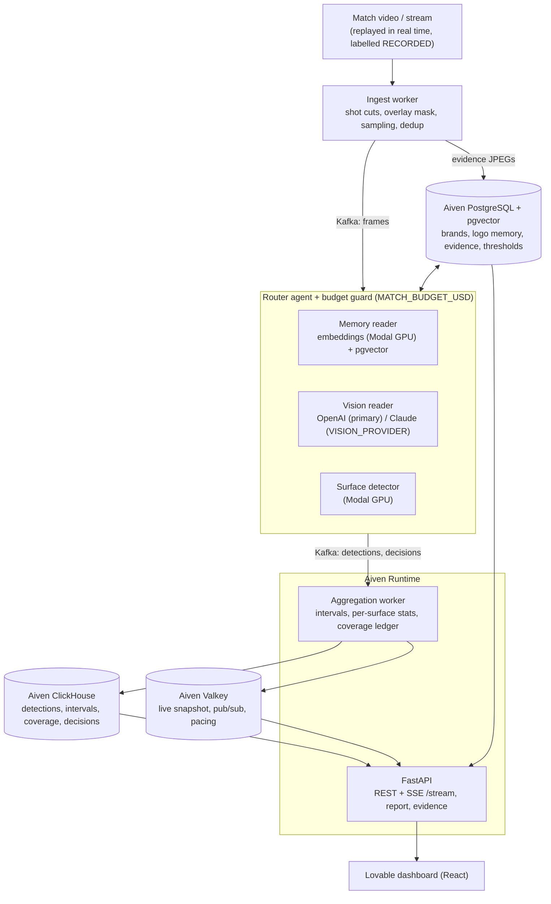

# SponsorPulse

**Live sponsor-exposure measurement for football broadcasts.** SponsorPulse watches a match as it
streams and measures, second by second, which sponsor is visible on which surface (LED perimeter,
static boards, shirts, backdrop), with the frame as evidence. A club's commercial team gets a live
dashboard and a per-sponsor report: seconds on screen, share of the match, close-ups, pacing against
the contracted target, and a coverage ledger that says which seconds were *not* measured and why.

Measurement is a deterministic pipeline. Agents sit only where a decision under uncertainty is
needed: a **router** that picks the cheapest reliable reader per shot within a per-match budget, a
**memory curator** that keeps each stadium's logo memory fresh, a **coverage detective** that hunts
unmeasured or conflicting seconds, and a **sponsor analyst** that answers open questions with its own
read-only SQL and timestamps. Router is built (stub readers on main); curator, detective and analyst
are planned (see Status).

> Demo data: the deployed app and the dashboard currently show the **SYNTHETIC** match
> `m-synthetic` (invented by `scripts/fake_stream.py`) or **MOCK** data (`docs/api-mock.json`).
> None of those figures is a measurement.

## Architecture



| Piece | Code | Store / service |
|---|---|---|
| Ingest: shot cuts, overlay mask, sampling, near-duplicate groups | `workers/ingest.py`, `vision/preprocess.py` | Aiven Kafka `frames`, Postgres `evidence` |
| Router: escalation memory -> vision -> second opinion, budget guard, per-stadium thresholds | `agents/router_policy.py`, `workers/router.py`, `vision/readers.py` | Kafka `detections`, `decisions`; Postgres `router_thresholds` |
| Vision identifier (OpenAI primary, Claude switchable via `VISION_PROVIDER`) | `vision/identify.py` (T08, in progress) | OpenAI / Anthropic API |
| Surface detector, embeddings | T07 / T09 (in progress) | Modal GPU, Postgres + pgvector `logo_memory` |
| Aggregation: intervals, brand and surface stats, LED timeline, coverage | `workers/aggregate.py`, `workers/aggregate_logic.py` | Aiven ClickHouse, Aiven Valkey |
| API: report, brand drill-down, decisions, coverage, evidence, SSE | `app/main.py`, `app/api/` | reads ClickHouse, Valkey, Postgres |
| Deploy: API + aggregation worker in one container | `deploy/runtime.py`, `Dockerfile`, `scripts/runtime_deploy.py` | Aiven Runtime |
| Evaluation: capture %, false-credit %, MAE, cost per match-minute, Claude-call share, latency | `eval/harness.py`, `eval/metrics.py` | run records in `eval/runs/` |
| Dashboard | built in Lovable (`docs/lovable-prompt.md`) | `VITE_API_BASE` -> the API |

Contracts (records, enums, API, metric definitions) are in `docs/CONTRACTS.md`; the build plan in
`docs/PLAN.md`; the live build state in `docs/HANDOFF.md`.

### Why each data service is there

- **Kafka**: the live stream between workers and agents (frames, detections, decisions). Small JSON
  only, no images.
- **ClickHouse**: per-second analytics: detections, intervals, coverage ledger, agent decisions; the
  analyst and the evaluation query it.
- **PostgreSQL + pgvector**: brands, stadiums, contracts, logo memory as vectors, evidence frames,
  learned router thresholds.
- **Valkey**: the live match snapshot, pub/sub for the SSE stream, decision and alert lists.
- **Runtime**: hosts the API and the aggregation worker from this public repo.

## Live deployment

**https://01a16333-2589-7299-babc-33f2830bf66a-8000.eur-1.aiven.app** (Aiven Runtime, plan
`startup-10-256`, $0.00959/h as published for that plan). Endpoints: `/health`, `/matches`,
`/matches/m-synthetic/report`, `/matches/m-synthetic/stream`, `/docs`. It loops the **SYNTHETIC**
match `m-synthetic` (60 s pass, 10 s pause). Details: `docs/DEPLOY.md`.

```bash
U=https://01a16333-2589-7299-babc-33f2830bf66a-8000.eur-1.aiven.app
curl -s $U/health
curl -sN "$U/matches/m-synthetic/stream?max_events=2"
```

Dashboard URL: `[[Lovable dashboard URL, to be added by the team]]`

## Run locally

Setup (Python 3.12):

```bash
python -m venv .venv && . .venv/bin/activate
pip install -e ".[dev,vision,llm,gpu]"
python scripts/aiven_env.py --write     # fills .env + data/certs from your Aiven project (needs AIVEN_TOKEN)
python -m scripts.migrate               # ClickHouse, Postgres, Kafka topics
```

**API with mock data only** (no services needed):

```bash
API_MOCK=1 uvicorn app.main:app --reload
curl -s localhost:8000/matches/m-demo-1/report      # MOCK match from docs/api-mock.json
```

**Synthetic match end to end on Aiven** (invented data):

```bash
python scripts/fake_stream.py --speed 1          # publishes the SYNTHETIC m-synthetic to Kafka
python -m workers aggregate                      # Kafka -> ClickHouse + Valkey
API_MOCK=0 uvicorn app.main:app                  # serves the live report and SSE
```

**Pipeline on a video file**:

```bash
python -m workers ingest --video path/to/match.mp4 --match-id m-test --source RECORDED [--dry-run]
python -m workers router --readers stub [--budget 3]   # stub readers until T07/T08/T09 land
python -m workers aggregate
```

`scripts/make_test_video.py` generates a test match video, so no real footage is needed.

**Same entrypoint as the deployed container**:

```bash
DEMO_SYNTHETIC=1 PORT=8765 AGG_GROUP=aggregate-local python -m deploy.runtime
# or: docker compose up --build
```

**Vision identifier** (T08, lands with the `t08-vision-identify` branch; OpenAI by default,
`VISION_PROVIDER` switches to Claude; `--max-usd` is a hard spend cap):

```bash
python -m vision.identify run --video path/to/match.mp4 --sponsors data/sponsors.csv --max-usd 1
```

**Evaluation** (writes a run record to `eval/runs/`; formats in `eval/runs/README.md`):

```bash
python -m eval.harness --pred pred.json --gold gold.csv --decisions decisions.json \
    --minutes 5 --name router-memory-heldout --source RECORDED
python -m eval.harness --compare eval/runs/a.json eval/runs/b.json --chart out.png
python -m eval.harness --reproduce eval/runs/a.json
```

Tests and lint: `python -m pytest -q`, `ruff check .`

### Configuration

Defaults from `docs/CONTRACTS.md` section 9, overridable by env: `SAMPLED_FPS=2`, `MIN_AREA_PCT=0.1`,
`MIN_SHARPNESS=50`, `CLOSEUP_AREA_PCT=3.0`, **`MATCH_BUDGET_USD=3`** (the router's hard per-match
spend limit; a group it cannot afford is recorded as unmeasured with reason `budget_cap`).

## Results

Every number here must come from a run record in `eval/runs/`. **No run record exists yet**, so all
values are placeholders. The reference is an **independent reference labelling** of a held-out
window (1 fps), not a hand count supplied by a club.

| Metric (definitions: CONTRACTS section 7) | Router + memory | Vision only | Baseline |
|---|---|---|---|
| Capture % | `[[capture_pct from eval/runs/<record>]]` | `[[capture_pct from eval/runs/<record>]]` | `[[capture_pct from eval/runs/<record>]]` |
| False-credit % | `[[false_credit_pct from eval/runs/<record>]]` | `[[...]]` | `[[...]]` |
| MAE s/brand | `[[mae_s from eval/runs/<record>]]` | `[[...]]` | `[[...]]` |
| Cost per match-minute (USD) | `[[cost_per_match_minute from eval/runs/<record>]]` | `[[...]]` | `[[...]]` |
| Vision-call share | `[[claude_call_share from eval/runs/<record>]]` | `[[...]]` | n/a |
| Frame -> dashboard latency p50 / p95 | `[[latency from eval/runs/<record>]]` | | |

Memory effect across matches (same stadium, equal accuracy): `[[vision-call share match 1 -> 3 from
eval/runs/<records>]]`.

Reproduce any row with `python -m eval.harness --reproduce eval/runs/<record>.json`.

## Status (honest)

- Working on main: ingest, router with **stub** readers and budget guard, aggregation into ClickHouse
  and Valkey, API with SSE, deployment on Aiven Runtime, evaluation harness. Shown with SYNTHETIC data.
- In progress: real readers (OpenAI/Claude vision identifier, surface detector and embeddings on
  Modal), memory curator, then frozen evaluation runs.
- Planned: coverage detective, sponsor analyst chat (the `/chat` endpoint is a stub today), board IDs
  via pitch homography.
- Known gap: the deployed worker keeps match state in memory; a restart resumes from Kafka offsets
  with empty state.

## Repo layout

```
app/       FastAPI app and shared contracts (app/contracts.py)
workers/   ingest, router, aggregation (python -m workers <name>)
vision/    preprocessing, reader protocols, vision identifier
agents/    router policy, prompts
db/        ClickHouse / Postgres migrations, Kafka topics, Valkey keys
eval/      harness, metrics, run records (eval/runs/)
deploy/    Aiven Runtime entrypoint
docs/      PLAN, CONTRACTS, HANDOFF, DEPLOY, PITCH
```

Agent rules for contributors: `AGENTS.md`.
